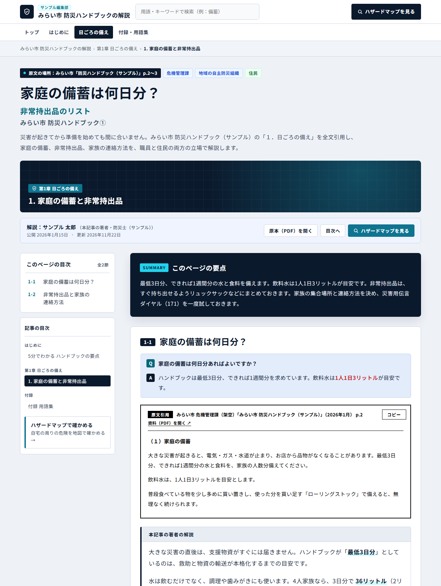

# pdf-skill — PDF資料を「原文＋解説」で読める解説サイトにするスキル

公的機関などの PDF 資料を、**原文をそのまま引用しながら一節ずつ解説する静的サイト**にするための、AIエージェント向けスキルです。
Claude Code・Codex・そのほか SKILL.md / AGENTS.md を読めるエージェントで使えます。人が手順書として読んで使うこともできます。



## できること

- PDF → ページ付きテキスト → 原文ブロック → Markdown 原稿 → **Python 1本でサイトを生成**
- 各節が「質問 → 答え → 原文引用 → 解説 → ポイント → 立場別の確認事項 → よくある疑問」の形になる
- 原文を PDF の文字と**機械照合**して、引用の誤りを 0 件にする
- 用語集と用語の個別ページ、本文から用語への自動リンク、同義語つきのサイト内検索
- 構造化データ（Article・FAQPage・DefinedTerm・パンくず）、OGP 画像、sitemap.xml、llms.txt
- デザインは Google Stitch のデザインシステム「Civic Cyber Sentinel」（濃紺×シアン）を CSS に移植。スマホはハンバーガーメニュー
- 必要なのは Python と `markdown`（OGP 画像に `pillow`、PDF 抽出に `pypdf` か Poppler の `pdftotext`）だけ。サーバー側のプログラムは不要

## 入れ方

### Claude Code

```bash
git clone https://github.com/MURAIMUNEAKI/pdf-skill.git ~/.claude/skills/pdf-skill
```

（プロジェクトだけで使うなら `.claude/skills/pdf-skill` に置く）。
Claude Code に「この PDF を解説サイトにして」と頼むと、スキルが使われます。

### Codex（OpenAI Codex CLI）

Codex は、ホームフォルダの中の `.codex\skills`（Mac/Linux は `~/.codex/skills`）に置かれたスキルを読みます。
そこに、このリポジトリを `pdf-skill` という名前のフォルダで置けば使えるようになります。

#### 0. 事前に必要なもの

- Codex CLI（ターミナルで `codex` と打って起動できること）
- Python 3.8 以上
- Git（無ければ、下の「Git を使わない入れ方」で入れる）

#### 1. ターミナルを開く

- **Windows**：スタートメニューで「PowerShell」（または「ターミナル」）と検索して開く
- **Mac**：Finder →「アプリケーション」→「ユーティリティ」→「ターミナル」

#### 2. スキルを置く（コマンドを1行ずつ貼り付けて Enter）

**Windows（PowerShell）**

```powershell
git clone https://github.com/MURAIMUNEAKI/pdf-skill.git "$env:USERPROFILE\.codex\skills\pdf-skill"
```

```powershell
pip install markdown pillow pypdf
```

```powershell
dir "$env:USERPROFILE\.codex\skills\pdf-skill"
```

**Mac / Linux**

```bash
git clone https://github.com/MURAIMUNEAKI/pdf-skill.git ~/.codex/skills/pdf-skill
```

```bash
pip3 install markdown pillow pypdf
```

```bash
ls ~/.codex/skills/pdf-skill
```

最後のコマンドで `SKILL.md` `template` `references` などが表示されれば、置けています。
（`.codex\skills` フォルダが無くても、`git clone` が自動で作ります）

**Git を使わない入れ方**

1. https://github.com/MURAIMUNEAKI/pdf-skill を開き、緑の「Code」ボタン →「Download ZIP」
2. ZIP を展開し、できたフォルダ `pdf-skill-main` の名前を **`pdf-skill`** に変える
3. そのフォルダを次の場所に移す（`.codex` は隠しフォルダなので、アドレスを直接入力して開く）
   - **Windows**：エクスプローラーのアドレス欄に `%USERPROFILE%\.codex\skills` と入力して Enter（「見つからない」と出たら、`%USERPROFILE%\.codex` を開いて `skills` フォルダを作る）
   - **Mac**：Finder で `⌘ + Shift + G` を押し、`~/.codex/skills` と入力（無ければ `~/.codex` に `skills` フォルダを作る）
4. `pdf-skill` の中に `SKILL.md` が直接入っていることを確かめる（`pdf-skill\pdf-skill-main\SKILL.md` のように一段深くなっていたら、中身を一段上に出す）

#### 3. Codex でスキルが見えるか確かめる

Codex をすでに起動していたら、いったん終了して起動し直します。Codex の入力欄で次のように打ちます。

```text
/skills
```

一覧に `pdf-skill` が出れば準備完了です。

#### 4. 使う

1. サイトを作るための空のフォルダを作り（例：デスクトップに `mysite-work`）、元の PDF をそこに入れる
2. ターミナルでそのフォルダに移動して Codex を起動する

   ```bash
   cd ~/Desktop/mysite-work
   ```

   ```bash
   codex
   ```

3. 次のように頼む。確実にこのスキルを使わせたいときは、頭に `$pdf-skill` を付ける

   ```text
   $pdf-skill この PDF（資料.pdf）を、原文と解説で読める解説サイトにして。
   サイト名は「〇〇の解説」、公開URLは https://example.com/xxx/ 、著者は〇〇。サイトはこのフォルダの mysite に作って。
   ```

Codex は作業フォルダの外に書き込めないことがあるので、サイトは作業フォルダの中（例 `./mysite`）に作るよう頼みます。

#### スキルを最新にする

```bash
git -C ~/.codex/skills/pdf-skill pull
```

（Windows は `git -C "$env:USERPROFILE\.codex\skills\pdf-skill" pull`。ZIP で入れた場合は、フォルダを入れ替える）

#### `/skills` に出ないとき（予備の方法）

Codex のバージョンによっては、スキル機能が無かったり置き場所が違ったりします。その場合は、作業フォルダに `AGENTS.md` というファイルを作り、次の1行を書きます。Codex は起動したフォルダの `AGENTS.md` を読むので、同じ手順で動きます。

```text
PDFから解説サイトを作るときは ~/.codex/skills/pdf-skill/SKILL.md を読み、その手順に従う。
```

（Windows で入れた場合は、パスを `C:\Users\<ユーザー名>\.codex\skills\pdf-skill\SKILL.md` に書き換える）

### そのほかのエージェント・人が使う場合

このリポジトリをどこかに置き、エージェントに `SKILL.md` を読ませるか、自分で `SKILL.md` の手順どおりに進めます。

## すぐ試す

```bash
pip install markdown pillow pypdf
cp -r pdf-skill/template mysite
python mysite/_build/build.py           # サンプル（架空の「みらい市 防災ハンドブック」）を生成
python mysite/_build/verify_quotes.py   # 照合 13 件、不一致 0 件
cd mysite && python -m http.server 8000 # http://localhost:8000/ を開く
```

自分の資料で作るときは、[SKILL.md](SKILL.md) の手順（PDF をテキストにする → `site.json` → 原稿 → ビルド → 照合 → 確認）に進みます。

## ファイル

```
SKILL.md                     スキルの本体（手順・守ること）
AGENTS.md                    Codex など AGENTS.md を読むエージェント向けの案内
references/
  manuscript-format.md       原稿（Markdown）の書き方
  site-json.md               site.json の全項目
  design.md                  デザインの部品・色・スマホの規則
  checklist.md               公開前の確認手順
template/                    サイトのひな形（このフォルダごとコピーして使う）
  _build/build.py            ビルド本体
  _build/site.json           設定（サンプル）
  _build/pdf_to_text.py      PDF → ページ付きテキスト
  _build/check_src.py        原稿の検査
  _build/verify_quotes.py    原文の照合
  _build/overflow375.html    スマホ幅の横はみ出し検査
  _build/src/ source/ raw/   原稿・原文ブロック・PDF抽出テキスト（サンプル）
  assets/style.css site.js   デザインと動き
```

## 注意

- 引用する資料の利用条件（政府標準利用規約、公共データ利用規約、著作権法の引用の要件など）を確認してから使ってください。サンプルの資料・著者・URL は架空です
- 生成したサイトが資料の発行者の公式サイトと誤解されないよう、フッターの注記（`site.json` の `footer_note`）を必ず書いてください
- このスキルは、日本DX応援団の解説サイト「不正アクセス・個人情報漏洩の対策」の作り方を汎用化したものです

## ライセンス

MIT License（[LICENSE](LICENSE)）。テンプレートで作ったサイトの文章・原稿の権利は、それを書いた人にあります。
